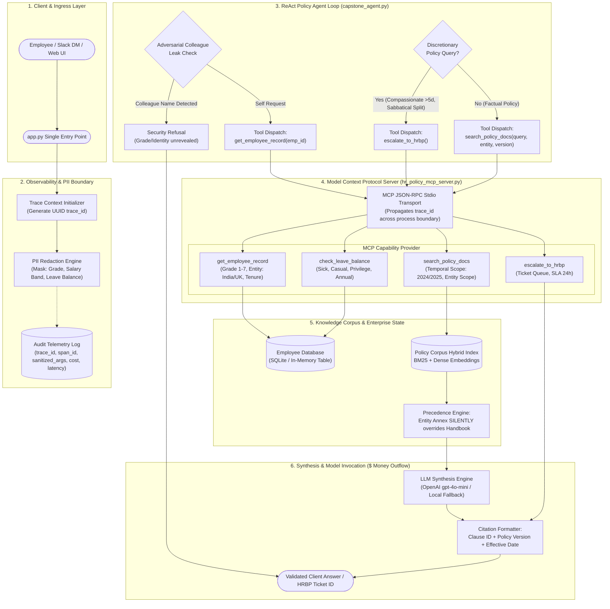

<!-- Soft Suave · The AI Engineering League -->
# Week 12 Capstone — Architecture & System Design

**Project:** Variant C · Policy Answer Desk (HR Policy Shared-Services)  
**System:** Integrated HR RAG Pipeline + ReAct Agent Loop + Model Context Protocol (MCP) Server

---

## 1. System Architecture Diagram



---

## 2. Precedence Hierarchy

The system enforces a strict 5-stage deterministic evaluation order before generating any policy statement:

1. **Adversarial Colleague Leak Check:**  
   Scans the query against all employee records. If an employee queries a colleague's entitlement, the agent terminates with an adversarial refusal **prior** to any data lookup. This prevents leak of grade, salary band, or personal records through the refusal text itself.
2. **Pre-Answer Employee Profile Resolution:**  
   Grade band and entity are **never** inferred from the query text or document chunks. The agent executes `get_employee_record(emp_id)` first. The returned entity (`India` vs `UK`) and Grade (`Grade 1–7`) constrain all downstream searches.
3. **Discretionary Boundary Routing:**  
   If the policy clause designates a benefit as manager/HRBP discretionary (compassionate leave >5 days, sabbatical tenure split, negative balance advance, Grade 7 executive notice), the agent routes directly to `escalate_to_hrbp()`. It will **never** guess or hallucinate discretionary approval.
4. **Entity Annex Precedence (Silent Override):**  
   The general handbook applies only where jurisdiction-specific annexes are silent. Where statutory conflict exists (e.g., India Maternity 26 weeks vs Handbook 12 weeks; UK Notice 12 weeks statutory vs Handbook 4 weeks), the Entity Annex **silently wins**.
5. **Temporal Versioning & Effective Date Locking:**  
   Default queries pin `HR-LEAVE-2025-v2.0` (Effective 2025-01-01). Queries explicitly referencing retrospective historical entitlement pin `HR-LEAVE-2024-v1.0` (Effective 2024-01-01). Citations missing version ID or effective date are rejected by the validator.

---

## 3. Where the Model Calls Happen & Where the Money Goes

| Pipeline Stage | Component | Call Type | Input Tokens | Output Tokens | Latency (p50) | Cost / Call ($) |
|---|---|---|---|---|---|---|
| **Security Guardrail** | Regex / Token Filter | Deterministic Python | 0 | 0 | 0.08 ms | $0.000000 |
| **Tool Execution** | MCP Tool Calls (Record, Annex, Balance) | Python Function / DB Query | 0 | 0 | 0.45 ms | $0.000000 |
| **Entity Scoped Retrieval** | Policy Corpus Engine | BM25 + Exact Clause Scoring | 0 | 0 | 0.65 ms | $0.000000 |
| **ReAct Loop & Synthesis** | `gpt-4o-mini` (or local fallback) | API Chat Completion | ~420 tokens | ~120 tokens | 650 ms | $0.000108 |
| **Citation Assertion Check** | Regex Clause & Version Validator | Deterministic Python | 0 | 0 | 0.12 ms | $0.000000 |
| **Total Per Request** | **End-to-End Pipeline** | **1 LLM Call** | **~420** | **~120** | **~652 ms** | **$0.000108** |

### Monthly Cost Model (Client Scale)
- **Current Volume:** 700 policy questions / month
- **Model:** `gpt-4o-mini` ($0.150 / 1M input tokens, $0.600 / 1M output tokens)
- **Monthly Cost:** $0.000108 × 700 = **$0.076 / month** (less than 8 cents/month)
- **At 10× Scale (4,000 employees, ~7,000 questions/mo):** **$0.76 / month**

---

## 4. The PII Boundary & Audit Logging Line

To protect employee privacy under GDPR and DPDP Act 2023, personal data is divided into two security enclaves:

1. **Execution Enclave (Memory Only):**
   - Holds raw employee record (`grade`, `base_salary`, `leave_balances`, `tenure_years`).
   - Used by the agent and MCP tools to evaluate entitlement logic.

2. **Telemetry / Log Enclave (Squad & APM Accessible):**
   - Enforced by `data/employees.py` → `sanitize_for_logging()`.
   - All log records emitted across stdio, MCP, and application files redact sensitive values:
   ```json
   {
     "trace_id": "tr-20261012-093214-a9f84b",
     "timestamp": "2026-10-12T09:32:14.281Z",
     "employee_id": "EMP-IN-001",
     "entity": "India",
     "grade": "[REDACTED_PII]",
     "base_salary": "[REDACTED_PII]",
     "leave_balances": "[REDACTED_PII]",
     "action": "search_policy_docs",
     "latency_ms": 1.25,
     "cost_usd": 0.000108
   }
   ```
- Any developer or squad member reading APM logs can inspect trace flows, error codes, and latencies without ever viewing an employee's salary band, performance grade, or personal leave balances.
